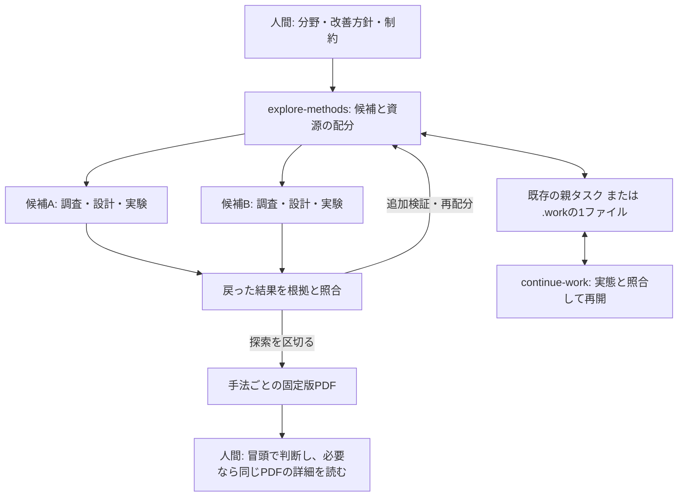

# Project Workflowsの構成

中心となる `explore-methods` が、人間の指定範囲の中で調査・設計・実験・判断・報告を進めます。
記録・整理・再開の3スキルは補助として独立して使えます。各SkillはMarkdownと表示用メタデータで構成し、
特定モデル、実験管理、プラグイン、ほかのSkillへの必須依存を持ちません。

## 配布物と責務

| 保存先 | 責務 |
| --- | --- |
| [explore-methods](../skills/explore-methods/SKILL.md) | 探索範囲、候補の区切り、依存関係、配分、比較、停止・追加検証、報告 |
| [判断用PDF](../skills/explore-methods/references/method-report.md) | 初見で判断できる内容、LaTeX生成、描画確認、固定版の納品 |
| [record-knowledge](../skills/record-knowledge/SKILL.md) | 記録先の選択、根拠と解釈の分離 |
| [記録の手引き](../skills/record-knowledge/references/records.md) | 実験の来歴、現行構造、調査に残す情報 |
| [curate-knowledge](../skills/curate-knowledge/SKILL.md) | 知見の統合、根拠の保全、文書の退役 |
| [continue-work](../skills/continue-work/SKILL.md) | 親子タスクの選択、実行状態の照合、継続と保存 |
| [チェックポイント](../skills/continue-work/references/checkpoint.md) | 既存の計画管理がない場合の小さな作業メモ |
| 各Skillの `agents/openai.yaml` と `LICENSE` | 表示用情報と、単独配布用MITライセンス |

探索の入口だけで必要な記録・状態保存・報告まで進められます。他の3つの導入や呼び出しは前提にしません。
各Skillのローカル参照はそのフォルダ内で完結します。報告の詳細は生成時に読む参照へ分けています。

## 分解と並列実行

分解の単位は、人間が独立して採否を判断する手法です。同じ仮説の設定違いや再試行は一つにまとめます。
研究では分野内の問い・手法を、Kaggleでは指定した改善方針の適用方法を具体化します。
共通データ・評価・ベースラインは共有し、依存関係のない作業を並列に進めます。

親の担当が全体予算と共有状態を管理し、各担当は専用の編集範囲と成果物を持ちます。
担当人数と計算枠は独立した制約です。起動済みの枠を予約として数え、戻った結果を確認してから
未消費の予算を再配分します。依存関係がなければ、全担当の終了を待って次の行動を決める必要はありません。

実行にはホストのサブエージェント、プロセス、既存ジョブ管理を使います。このリポジトリは独自の
schedulerやrunnerを実装しません。実行機能がなければ同じ分解で逐次実行し、制約を報告します。

## 根拠、状態、報告の所有権

- 実行の設定・ログ・データ・成果物は既存の実験管理や保存先に置き、実行時の版を保ちます。
- Markdownは調査・実験の解釈と根拠への参照、現在のコードの説明を担います。
- 親タスクは候補、担当、依存関係、予算、ジョブ、現在の判断と次の行動を持ちます。
  子の詳細を複製せず参照し、共有状態を更新する担当を一人にします。
- PDFは、その手法について報告した時点の判断と根拠を自己完結した形で示す固定版です。

PDFの冒頭は判断の入口、後半はその判断を検討できる詳細です。独立した要約版と詳細版には分けません。
生成用texは一時ファイルであり、納品用の編集原稿を維持しません。報告を訂正する必要がある場合は
新しいPDFを作り、現在の1本へのリンクを更新します。旧版との関係は補助記録に残します。

判断は共通条件の測定結果に基づけます。失敗・中断、調査だけの期待、未検証の新規性、違う分割の
スコアを成功例に混ぜません。選択に使った評価と選択後の確認を分け、予算が足りない場合は限界を示します。

## 既存3スキルとの連携

記録では実行当時の条件を保ち、現在のHEADや設定で置き換えません。整理では否定的な結果、失敗、
再現のための唯一の情報も残存文書へ移します。納品済みPDFは整理対象のMarkdownと分けて保ちます。

Markdownの削除には、対象範囲、固有情報の移動、利用可能な根拠、削除する版のGit保存、参照の修復が
必要です。未追跡・未commitの原本は、保存する権限がなければ残します。文書整理から設定・データ・
ソースコード・成果物を削除する権限は生じません。

再開では親タスクを選び、関連する子タスク、差分、実際のジョブと成果物を照合します。状態不明の実行を
重複起動せず、残りの予算も確認します。保存したコマンドや承認の記述から、新しい実行権限は生じません。
保存前のクラッシュや外部成果物の消失を復元する機能はなく、保存先自体の永続性は導入環境が担います。

## 検証の境界

[配布検査](../tests/test_distribution.py)は公式形式、単独コピー、参照、表示情報、ライセンスと合成評価器を
確認します。[行動ケース](../evals/cases.md)では分解・配分、資源の制約、比較、PDF、記録・整理・再開を
根拠と照合します。実施結果と未確認の範囲は[評価記録](../evals/results.md)に残します。
実科学の性能改善、長期の運用、ホストによる自動選択は、合成ケースだけでは評価できません。
